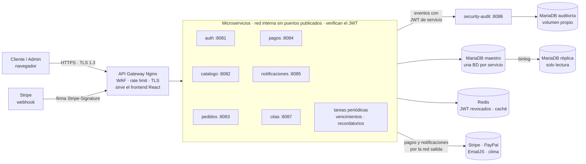
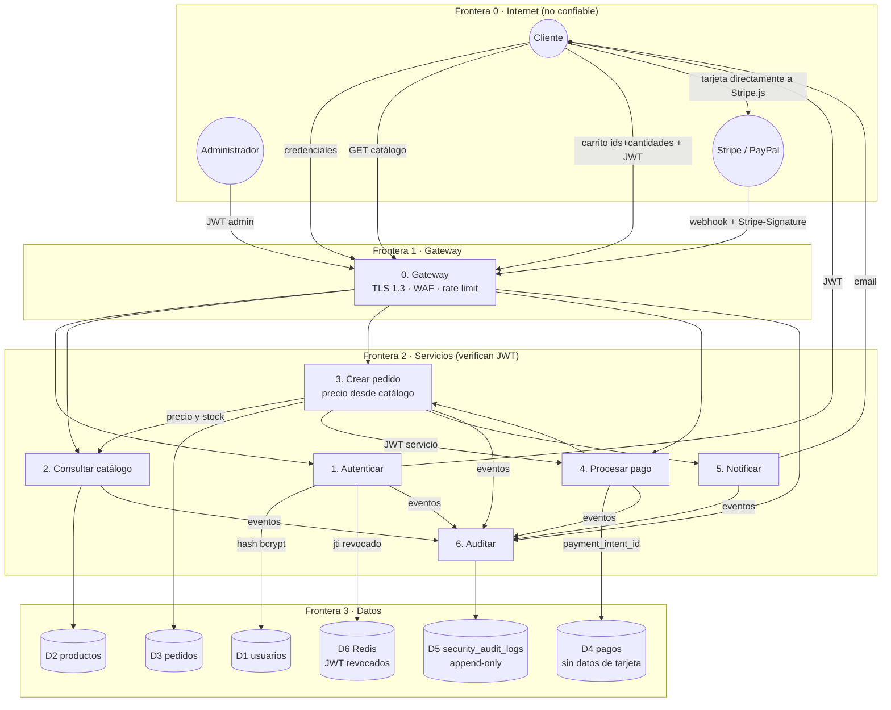
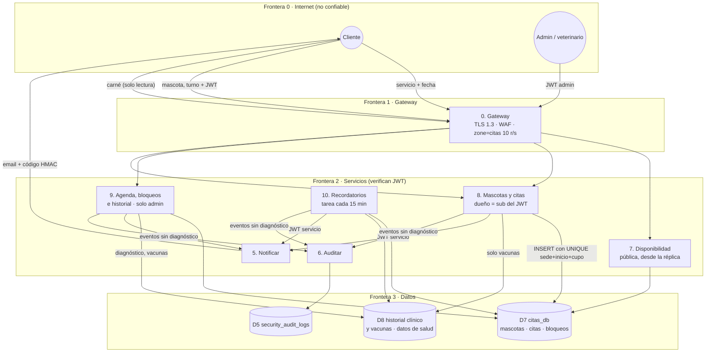

# Huellitas — Arquitectura, DFD y modelo de amenazas STRIDE

**Negocio:** tienda en línea de productos para mascotas (alimento, accesorios, farmacia veterinaria) de la veterinaria *Huellitas*.
Es distinto del Proyecto 1 (POS de librería y papelería escolar).

**Flujo de compra:** catálogo → carrito → checkout → pago (Stripe / PayPal sandbox) → confirmación por email (EmailJS) → entrega (domicilio o retiro en sede).

**Flujo de citas (FASE 15):** servicio (la sede sale del servicio) → día → turno libre → mascota → reserva → correo con código de verificación → confirmación del admin → consulta con historial clínico y carné de vacunas → recordatorios. Las citas se pagan en la sede, así que este flujo no toca PCI-DSS.

---

## 1. Arquitectura de microservicios



**Llamadas entre servicios** (todas con JWT de servicio de 60 s y un solo uso; el receptor tiene su lista de servicios permitidos):

| Quién llama | A quién | Para qué |
|---|---|---|
| pedidos | catálogo | Precio vigente y reserva de stock |
| pedidos | pagos | Iniciar el pago del pedido |
| pagos | pedidos | Marcar el pedido como pagado tras el webhook |
| pedidos, citas, citas-recordatorios | notificaciones | Correos de pedido y de cita, avisos de vacuna y clima del panel admin |
| todos | security-audit | Registrar eventos en la bitácora |

`catalogo-service` y `citas-service` leen de la réplica (catálogo y disponibilidad) para no cargar al maestro. Solo `pagos-service` y `notificaciones-service` están en la red `salida` con acceso a Internet.

| Componente | Estado | Tecnología | Puerto |
|---|---|---|---|
| API Gateway | ✅ semana 1 | Nginx 1.27 Alpine | 80/443 (host 8088/8443 en local) |
| auth-service | ✅ semana 1 | PHP 8.3 + Apache (www-data) · auth_db | 8081 interno |
| security-audit-service | ✅ semana 1 | PHP 8.3 + Apache (www-data) · audit_db | 8086 interno |
| MariaDB master / slave | ✅ semana 1 | MariaDB 10.6, replicación por binlog | 3306 interno |
| MariaDB audit | ✅ semana 1 | MariaDB 10.6, volumen `audit_data` | 3306 interno |
| Redis | ✅ semana 1 | Redis 7, AOF, contraseña | 6379 interno |
| catalogo-service | ✅ semana 2 | PHP 8.3 · catalogo_db (lee de la réplica) · Redis · Cloudinary | 8082 interno |
| pedidos-service | ✅ semana 2 | PHP 8.3 · pedidos_db | 8083 interno |
| pagos-service | ✅ semana 3 | PHP 8.3 · pagos_db · Stripe/PayPal · red `salida` | 8084 interno |
| notificaciones-service | ✅ semana 3 | PHP 8.3 · EmailJS · OpenWeatherMap/Open-Meteo · red `salida` | 8085 interno |
| citas-service | ✅ FASE 15 | PHP 8.3 · citas_db (disponibilidad desde la réplica) · Redis · sin salida a Internet | 8087 interno |
| citas-recordatorios | ✅ FASE 15 | Misma imagen que citas-service; tarea periódica sin puerto | — |

Con `citas-service` la arquitectura queda en **7 microservicios** (auth, catálogo, pedidos, pagos, notificaciones, auditoría y citas), más dos tareas periódicas (`pedidos-vencimientos` y `citas-recordatorios`).

### Zero Trust

Ningún servicio confía en la red interna. Cada petición, sea del navegador o de otro servicio, trae un JWT que se verifica en el servicio que la recibe:

- **JWT de usuario** (`typ=user`, firmado con `JWT_SECRET`, 1 h). El servicio verifica la firma HS256, `exp` e `iss`, y comprueba que el `jti` no esté en la lista negra de Redis. El rol sale del token firmado. Código: `services/shared/src/Guard.php::usuario()`.
- **JWT de servicio** (`typ=service`, firmado con un secreto distinto, `SERVICE_JWT_SECRET`, 60 s, de un solo uso). `sub` identifica al servicio que llama, y el receptor tiene una lista de servicios permitidos. Código: `Guard::servicio()`.
- Si Redis no está disponible, la verificación **falla cerrada** (503): sin la lista negra, el servicio no acepta tokens.

---

## 2. Diagrama de flujo de datos (DFD) del ciclo de compra

Las líneas punteadas son **fronteras de confianza**. Cada flujo que cruza una frontera tiene un control asociado.



**Puntos clave del DFD**

1. **El número de tarjeta nunca cruza nuestras fronteras.** Va del navegador a Stripe.js o PayPal. Nosotros guardamos solo el `payment_intent_id`.
2. **El cliente manda IDs de producto y cantidades, no precios.** `pedidos-service` consulta el precio a `catalogo-service` en el servidor.
3. Los servicios se identifican entre sí con un JWT de servicio de un solo uso, porque la red interna no se considera confiable.

### 2.1 DFD del flujo de citas



**Puntos clave del flujo de citas**

1. **El dueño sale del token.** Mascotas, citas y carné se filtran por `id_cliente = sub`. Si el recurso es de otro cliente se responde 404, igual que si no existiera, y queda `ACCESO_DENEGADO`.
2. **La base decide quién se queda el turno.** El índice `UNIQUE (sede, inicio, cupo)` impide la doble reserva aunque lleguen varias peticiones a la vez. No depende de que el código lea la disponibilidad antes.
3. **Datos de salud separados.** El diagnóstico y el tratamiento solo los ve el admin, y cada lectura se audita. El cliente ve el carné de vacunas sin diagnósticos. La bitácora guarda qué se registró (vacunas, peso), no el diagnóstico.
4. **La tarea de recordatorios no tiene puerto.** El script está fuera de `public/`, así que nadie lo puede llamar por HTTP.

---

## 3. Modelo STRIDE

| STRIDE | Flujo / activo | Ataque | Contramedida | Dónde está | Estado |
|---|---|---|---|---|---|
| **S** Spoofing | Login (P1) | Credential stuffing, fuerza bruta | bcrypt cost 12; bloqueo de la cuenta 15 min tras 5 fallos; 50 intentos por IP cada 15 min; 20 req/min por IP en `/login` en el gateway; si la misma cuenta falla desde ≥3 IPs, el evento se marca `FRAUDE`; mismo mensaje y mismo tiempo de respuesta exista o no el correo | `services/auth/src/AuthController.php` (`login()`, `fallo()`, `HASH_SENUELO`), `gateway/default.conf.template` (`zone=login`) | ✅ |
| **S** Spoofing | Servicio → servicio | Un contenedor comprometido se hace pasar por otro | JWT de servicio con secreto aparte, 60 s, de un solo uso (anti-replay en Redis); lista de servicios permitidos | `services/shared/src/Guard.php::servicio()` | ✅ |
| **T** Tampering | Carrito → pedido (P3) | Cambiar el precio en `POST /api/pedidos` | Solo se reenvían `variante_id` y `cantidad`; el precio se lee del maestro en `catalogo-service`; descuento y envío se calculan en el servidor, en centavos | `PedidosController::cotizarEnCatalogo()`, `StockController::cotizar()`, `Totales.php` | ✅ |
| **T** Tampering | Token (P1) | Editar el payload del JWT o usar `alg=none` | Solo HS256; firma comparada en tiempo constante (`hash_equals`) | `services/shared/src/Jwt.php::verificar()` | ✅ |
| **T** Tampering | Webhook de pago (P4) | Enviar un `payment_intent.succeeded` falso o reenviar uno viejo | Firma `Stripe-Signature` (HMAC, tolerancia 5 min), idempotencia por `event_id`, verificación de monto, moneda y pedido | `Stripe::firmaValida()`, `PagosController::webhookStripe()` | ✅ |
| **T** Tampering | Bitácora (D5) | Borrar o alterar los rastros | Triggers que prohíben UPDATE/DELETE incluso a root; `audit_user` solo con INSERT/SELECT; cadena de hashes SHA-256 verificable | `db/audit/01-audit_db.sh`, `AuditController::integridad()` | ✅ |
| **R** Repudiation | Pedido (P3) | El cliente niega haber hecho un pedido | `PEDIDO_CREADO` con cliente, IP, user-agent, líneas y precios; historial de estados con quién los cambió | `PedidosController::crear()`, tabla `historial_estados` | ✅ |
| **R** Repudiation | Pago (P4) | El cliente niega haber pagado | `PAGO_INICIADO` y `PAGO_CONFIRMADO` con el `payment_intent_id` de Stripe (inmutable del lado de Stripe), IP y user-agent; email con código de verificación HMAC | `PagosController`, `NotificacionesController::codigo()` | ✅ |
| **R** Repudiation | Cualquier acción | Un servicio reporta eventos que no le corresponden | `servicio` se toma del token, no del cuerpo; cada código de evento tiene sus servicios permitidos; la hora la pone el audit-service | `AuditController::EVENTOS` | ✅ |
| **I** Info Disclosure | Pedidos (D3) | `GET /api/pedidos` de otros clientes, IDs secuenciales | `WHERE id_cliente = <sub del JWT>` en todas las consultas; pedidos con **UUID v4**; 404 también cuando es ajeno, y queda registrado `ACCESO_DENEGADO` | `PedidosController::misPedidos()`, `ver()` | ✅ |
| **I** Info Disclosure | Errores | Stack traces, versión del servidor | `display_errors=Off`; errores genéricos en JSON; `server_tokens off`; `ServerTokens Prod`; sin `X-Powered-By` | `services/shared/src/Router.php`, `services/Dockerfile` | ✅ |
| **I** Info Disclosure | Tránsito | Sniffing | Solo TLS 1.3, HSTS, HTTP → 301 a HTTPS | `gateway/default.conf.template` | ✅ |
| **D** DoS | Catálogo (P2) | Scraping masivo o inundación | Rate limit por IP y por servicio, `limit_conn`, catálogo servido desde Redis y leído de la réplica, CDN de Cloudinary, `mem_limit`/`cpu_shares` por contenedor; el stock exacto no se publica | `gateway/default.conf.template`, `CatalogoController::listar()` | ✅ |
| **S** Spoofing | Correo de la cita | Correo falso que dice venir de Huellitas, o un cliente que niega haber reservado | Código HMAC `cita\|id\|inicio` con `COMPROBANTE_SECRET` en el correo y en «Mis citas»; solo `citas-service` puede pedir correos de citas a notificaciones | `CitasController::notificar()`, `NotificacionesController` | ✅ CP-42 |
| **T** Tampering | Reserva (P8) | Reservar dos veces el mismo cupo enviando peticiones a la vez | `UNIQUE (sede, inicio, cupo)` y `UNIQUE (mascota_id, inicio)` en la BD; se prueba cada cupo dentro de una transacción y el índice decide | `CitasController::crear()`, `db/master/07-citas_db.sql` | ✅ CP-39 |
| **T** Tampering | Bloqueo de turnos (P9) | Una reserva que entra mientras el admin bloquea el turno | `bloquear()` toma el rango con `FOR UPDATE` y la reserva vuelve a leer los bloqueos antes de confirmar; no se bloquea un rango con citas activas | `CitasController::bloquear()`, `crear()` | ✅ CP-43 |
| **R** Repudiation | Citas y consultas | El cliente niega haber reservado o cancelado; el admin niega un cambio de estado o un diagnóstico | `CITA_CREADA`, `CITA_CANCELADA` y `CITA_ESTADO_CAMBIADO` con estado anterior y nuevo; tabla `historial_citas` con quién hizo cada cambio; `HISTORIAL_REGISTRADO` con autor, vacunas y peso | `CitasController::moverEstado()`, `registrarHistorial()` | ✅ CP-40, CP-44 |
| **I** Info Disclosure | Mascotas, citas y carné (D7) | Ver las mascotas, el teléfono o las vacunas de otro cliente cambiando el ID | Filtro por `sub` del JWT, IDs UUID v4, 404 cuando es ajeno y `ACCESO_DENEGADO` en la bitácora | `mascotaPropia()`, `citaPropia()`, `carne()` | ✅ CP-37, CP-45 |
| **I** Info Disclosure | Historial clínico (D8) | Un cliente lee diagnósticos, o la bitácora se vuelve una copia de los datos de salud | Historial solo con `Guard::usuario(['admin'])` y cada lectura auditada (`HISTORIAL_CONSULTADO`); el carné no trae diagnóstico ni tratamiento; la bitácora no los copia (minimización, A.5.34) | `historialAdmin()`, `carne()`, `registrarHistorial()` | ✅ CP-44, CP-45 |
| **D** DoS | Agenda (P8) | Un cliente reserva todos los turnos para bloquear la agenda | Máximo 5 citas próximas por cliente; `zone=citas` (10 r/s, ráfaga 40) en el gateway; reservas hasta 60 días adelante y con 1 h de anticipación | `CitasController::MAX_ACTIVAS`, `gateway/default.conf.template` | ✅ CP-41 |
| **E** Elevation of Privilege | Agenda, bloqueos e historial | Un cliente cambia estados, bloquea turnos o registra consultas | Todas las rutas `/api/citas/admin/*` exigen `Guard::usuario(['admin'])`; las transiciones de estado salen de una tabla fija | `CitasController::TRANSICIONES`, `cambiarEstado()` | ✅ CP-40, CP-43 |
| **E** Elevation of Privilege | Panel admin | Manipular el JWT o enviar `rol=admin` al registrarse | El rol solo sale del token firmado; el registro público siempre crea `cliente`; `Guard::usuario(['admin'])` en cada ruta administrativa; intento de cliente en el panel → `ACCESO_ADMIN_PANEL FALLO` | `AuthController::registro()`, `accesoAdmin()`, `Guard.php` | ✅ |

### Riesgo residual que se acepta

- El WAF de Nginx usa firmas (lista negra) y puede saltarse con codificaciones raras. Por eso hay una segunda capa en PHP (`Validar::sinAtaques`) y, sobre todo, el 100 % de las consultas usa prepared statements reales (`PDO::ATTR_EMULATE_PREPARES => false`).
- El JWT revocado se busca en Redis. Si Redis cae, los servicios devuelven 503 en lugar de aceptar tokens sin verificar: se prefiere la disponibilidad reducida a la seguridad reducida.

---

## 4. Evidencia automática

`tests/seguridad.sh` verifica contra el stack levantado los controles marcados con ✅: TLS, cabeceras, JWT, bloqueo, WAF, Zero Trust, bitácora append-only, hardening Docker, replicación y el módulo de citas (CP-37 a CP-46).

```bash
docker compose up -d --build
tests/seguridad.sh
```
