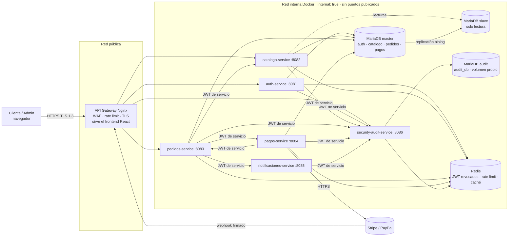
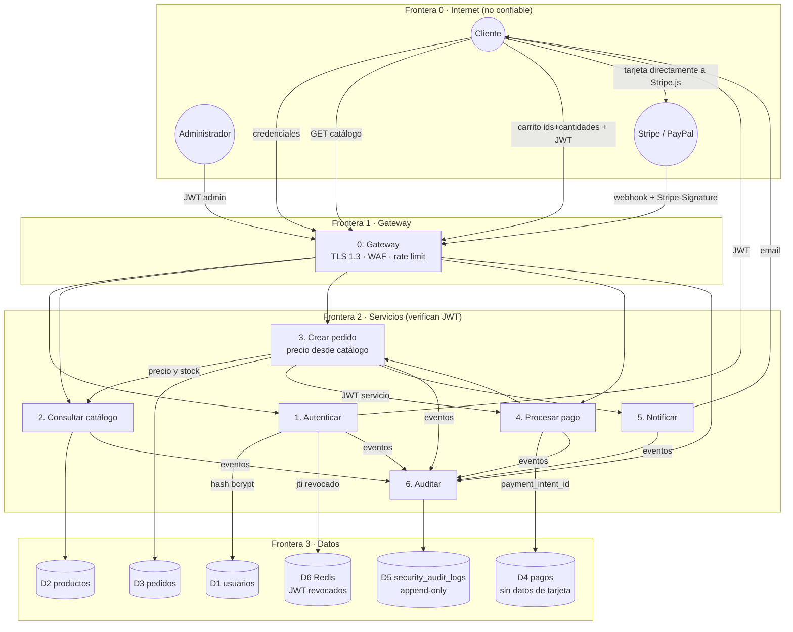

# Huellitas — Arquitectura, DFD y modelo de amenazas STRIDE

**Negocio:** tienda en línea de productos para mascotas (alimento, accesorios, farmacia veterinaria) de la veterinaria *Huellitas*.
Es distinto del Proyecto 1 (POS de librería y papelería escolar).

**Flujo de compra:** catálogo → carrito → checkout → pago (Stripe / PayPal sandbox) → confirmación por email (EmailJS) → entrega (domicilio o retiro en sede).

---

## 1. Arquitectura de microservicios



| Componente | Estado | Tecnología | Puerto |
|---|---|---|---|
| API Gateway | ✅ semana 1 | Nginx 1.27 Alpine | 80/443 (host 8088/8443 en local) |
| auth-service | ✅ semana 1 | PHP 8.3 + Apache (www-data) · auth_db | 8081 interno |
| security-audit-service | ✅ semana 1 | PHP 8.3 + Apache (www-data) · audit_db | 8086 interno |
| MariaDB master / slave | ✅ semana 1 | MariaDB 10.6, replicación por binlog | 3306 interno |
| MariaDB audit | ✅ semana 1 | MariaDB 10.6, volumen `audit_data` | 3306 interno |
| Redis | ✅ semana 1 | Redis 7, AOF, contraseña | 6379 interno |
| catalogo-service | ✅ semana 2 | PHP 8.3 · catalogo_db (lee de la réplica) · Redis · Cloudinary | 8082 interno |
| pedidos-service | ✅ semana 2 | PHP 8.3 · pedidos_db | 8083 interno |
| pagos-service | ✅ semana 3 | PHP 8.3 · pagos_db · Stripe/PayPal · red `salida` | 8084 interno |
| notificaciones-service | ✅ semana 3 | PHP 8.3 · EmailJS · red `salida` | 8085 interno |

### Zero Trust

Ningún servicio confía en la red interna. Cada petición, sea del navegador o de otro servicio, trae un JWT que se verifica en el servicio que la recibe:

- **JWT de usuario** (`typ=user`, firmado con `JWT_SECRET`, 1 h). El servicio verifica la firma HS256, `exp` e `iss`, y comprueba que el `jti` no esté en la lista negra de Redis. El rol sale del token firmado. Código: `services/shared/src/Guard.php::usuario()`.
- **JWT de servicio** (`typ=service`, firmado con un secreto distinto, `SERVICE_JWT_SECRET`, 60 s, de un solo uso). `sub` identifica al servicio que llama, y el receptor tiene una lista de servicios permitidos. Código: `Guard::servicio()`.
- Si Redis no está disponible, la verificación **falla cerrada** (503): sin la lista negra, el servicio no acepta tokens.

---

## 2. Diagrama de flujo de datos (DFD) del ciclo de compra

Las líneas punteadas son **fronteras de confianza**. Cada flujo que cruza una frontera tiene un control asociado.



**Puntos clave del DFD**

1. **El número de tarjeta nunca cruza nuestras fronteras.** Va del navegador a Stripe.js o PayPal. Nosotros guardamos solo el `payment_intent_id`.
2. **El cliente manda IDs de producto y cantidades, no precios.** `pedidos-service` consulta el precio a `catalogo-service` en el servidor.
3. Los servicios se identifican entre sí con un JWT de servicio de un solo uso, porque la red interna no se considera confiable.

---

## 3. Modelo STRIDE

| STRIDE | Flujo / activo | Ataque | Contramedida | Dónde está | Estado |
|---|---|---|---|---|---|
| **S** Spoofing | Login (P1) | Credential stuffing, fuerza bruta | bcrypt cost 12; bloqueo de la cuenta 15 min tras 5 fallos; 50 intentos por IP cada 15 min; 20 req/min por IP en `/login` en el gateway; si la misma cuenta falla desde ≥3 IPs, el evento se marca `FRAUDE`; mismo mensaje y mismo tiempo de respuesta exista o no el correo | `services/auth/src/AuthController.php` (`login()`, `fallo()`, `HASH_SENUELO`), `gateway/default.conf.template` (`zone=login`) | ✅ |
| **S** Spoofing | Servicio → servicio | Un contenedor comprometido se hace pasar por otro | JWT de servicio con secreto aparte, 60 s, de un solo uso (anti-replay en Redis); lista de servicios permitidos | `services/shared/src/Guard.php::servicio()` | ✅ |
| **T** Tampering | Carrito → pedido (P3) | Cambiar el precio en `POST /api/pedidos` | Solo se reenvían `variante_id` y `cantidad`; el precio se lee del maestro en `catalogo-service`; descuento y envío se calculan en el servidor, en centavos | `PedidosController::cotizarEnCatalogo()`, `StockController::cotizar()`, `Totales.php` | ✅ |
| **T** Tampering | Token (P1) | Editar el payload del JWT o usar `alg=none` | Solo HS256; firma comparada en tiempo constante (`hash_equals`) | `services/shared/src/Jwt.php::verificar()` | ✅ |
| **T** Tampering | Webhook de pago (P4) | Enviar un `payment_intent.succeeded` falso o reenviar uno viejo | Firma `Stripe-Signature` (HMAC, tolerancia 5 min), idempotencia por `event_id`, verificación de monto, moneda y pedido | `Stripe::firmaValida()`, `PagosController::webhookStripe()` | ✅ |
| **T** Tampering | Bitácora (D5) | Borrar o alterar los rastros | Triggers que prohíben UPDATE/DELETE incluso a root; `audit_user` solo con INSERT/SELECT; cadena de hashes SHA-256 verificable | `db/audit/01-audit_db.sh`, `AuditController::integridad()` | ✅ |
| **R** Repudiation | Pedido (P3) | El cliente niega haber hecho un pedido | `PEDIDO_CREADO` con cliente, IP, user-agent, líneas y precios; historial de estados con quién los cambió | `PedidosController::crear()`, tabla `historial_estados` | ✅ |
| **R** Repudiation | Pago (P4) | El cliente niega haber pagado | `PAGO_INICIADO` y `PAGO_CONFIRMADO` con el `payment_intent_id` de Stripe (inmutable del lado de Stripe), IP y user-agent; email con código de verificación HMAC | `PagosController`, `NotificacionesController::codigo()` | ✅ |
| **R** Repudiation | Cualquier acción | Un servicio reporta eventos que no le corresponden | `servicio` se toma del token, no del cuerpo; cada código de evento tiene sus servicios permitidos; la hora la pone el audit-service | `AuditController::EVENTOS` | ✅ |
| **I** Info Disclosure | Pedidos (D3) | `GET /api/pedidos` de otros clientes, IDs secuenciales | `WHERE id_cliente = <sub del JWT>` en todas las consultas; pedidos con **UUID v4**; 404 también cuando es ajeno, y queda registrado `ACCESO_DENEGADO` | `PedidosController::misPedidos()`, `ver()` | ✅ |
| **I** Info Disclosure | Errores | Stack traces, versión del servidor | `display_errors=Off`; errores genéricos en JSON; `server_tokens off`; `ServerTokens Prod`; sin `X-Powered-By` | `services/shared/src/Router.php`, `services/Dockerfile` | ✅ |
| **I** Info Disclosure | Tránsito | Sniffing | Solo TLS 1.3, HSTS, HTTP → 301 a HTTPS | `gateway/default.conf.template` | ✅ |
| **D** DoS | Catálogo (P2) | Scraping masivo o inundación | Rate limit por IP y por servicio, `limit_conn`, catálogo servido desde Redis y leído de la réplica, CDN de Cloudinary, `mem_limit`/`cpu_shares` por contenedor; el stock exacto no se publica | `gateway/default.conf.template`, `CatalogoController::listar()` | ✅ |
| **E** Elevation of Privilege | Panel admin | Manipular el JWT o enviar `rol=admin` al registrarse | El rol solo sale del token firmado; el registro público siempre crea `cliente`; `Guard::usuario(['admin'])` en cada ruta administrativa; intento de cliente en el panel → `ACCESO_ADMIN_PANEL FALLO` | `AuthController::registro()`, `accesoAdmin()`, `Guard.php` | ✅ |

### Riesgo residual que se acepta

- El WAF de Nginx usa firmas (lista negra) y puede saltarse con codificaciones raras. Por eso hay una segunda capa en PHP (`Validar::sinAtaques`) y, sobre todo, el 100 % de las consultas usa prepared statements reales (`PDO::ATTR_EMULATE_PREPARES => false`).
- El JWT revocado se busca en Redis. Si Redis cae, los servicios devuelven 503 en lugar de aceptar tokens sin verificar: se prefiere la disponibilidad reducida a la seguridad reducida.

---

## 4. Evidencia automática

`tests/seguridad.sh` verifica contra el stack levantado los controles marcados con ✅: TLS, cabeceras, JWT, bloqueo, WAF, Zero Trust, bitácora append-only, hardening Docker y replicación.

```bash
docker compose up -d --build
tests/seguridad.sh
```
