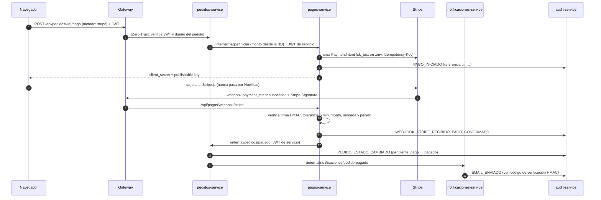

# Huellitas — Seguridad del módulo de pagos (PCI-DSS básico)

Huellitas cobra con **Stripe** (tarjeta) y **PayPal**, ambos en modo sandbox. El diseño busca que el sistema **nunca toque los datos de tarjeta**: así queda en el alcance más reducido de PCI-DSS (SAQ A) y una brecha de nuestras bases de datos no expondría tarjetas.

## Flujo



PayPal sigue el mismo esquema: `pagos-service` crea la orden (Orders v2) y la **captura del lado del servidor**. Solo la da por buena si `status = COMPLETED`, el monto y la moneda coinciden con el pago guardado, y el `custom_id` es el pedido correcto.

## Los 6 requisitos

| # | Requisito | Implementación | Código | Prueba |
|---|---|---|---|---|
| 1 | **No almacenar datos de tarjeta** | `pagos` guarda solo `payment_intent_id` (o el Order ID de PayPal), el estado de la pasarela y el monto. Ninguna tabla de las 4 bases tiene columnas de número, CVV o vencimiento | `db/master/05-pagos_db.sql` | CP-28 |
| 2 | **Cifrado en tránsito** | Gateway solo con TLS 1.3, HSTS y HTTP → 301. Las llamadas a Stripe/PayPal/EmailJS fuerzan HTTPS (`CURLPROTO_HTTPS`) y verifican el certificado | `gateway/default.conf.template`, `services/pagos/src/Pasarela.php` | CP-01, CP-02 |
| 3 | **Control de acceso** | `/internal/pagos/*` solo acepta a `pedidos-service` con JWT de servicio de un solo uso. El gateway no publica `/api/pagos/*`, salvo el webhook. El cliente solo puede pagar **sus** pedidos, y el monto sale de la BD, no del navegador | `PagosController::iniciar()`, `PedidosController::iniciarPago()`, `propio()` | CP-29 |
| 4 | **Logging de transacciones** | `PAGO_INICIADO` (éxito y fallo), `PAGO_CONFIRMADO`, `PAGO_FALLIDO` (FALLO o FRAUDE), `WEBHOOK_STRIPE_RECIBIDO` y `PAGO_REEMBOLSADO`, todos con la referencia de la pasarela, el `pago_id` y el `pedido_id` | `PagosController` | CP-26, CP-27 |
| 5 | **Verificación de webhooks** | `Stripe-Signature`: HMAC-SHA256 de `t.payload` con el Webhook Secret, comparación en tiempo constante y tolerancia de 300 s (anti-replay). Sin firma → 400 + evento FALLO; firma falsa → 400 + evento FRAUDE. Cada evento se procesa una sola vez (`webhook_eventos`) | `services/pagos/src/Stripe.php::firmaValida()` | CP-26 |
| 6 | **API keys en entorno** | `STRIPE_SECRET_KEY`, `STRIPE_WEBHOOK_SECRET`, `PAYPAL_CLIENT_SECRET` y `EMAILJS_PRIVATE_KEY` solo en `.env` (en `.gitignore`), inyectadas únicamente en el contenedor que las usa. El navegador recibe solo las claves públicas (`pk_test`, `client-id`) | `docker-compose.yml`, `.env.example` | CP-30 |

## Controles adicionales

- **Monto manipulado en el webhook.** Aunque la firma sea válida, si `amount_received`, la moneda o `metadata.pedido_id` no coinciden con el pago guardado, el pedido **no** se confirma y queda `PAGO_FALLIDO` con resultado `FRAUDE` (CP-27).
- **Doble cobro.** Un pedido pagado no se puede volver a pagar (409). La Idempotency-Key de Stripe y el `PayPal-Request-Id` hacen que repetir la llamada no cree otro cobro.
- **Pagado después de cancelar.** Si llega la confirmación de un pedido ya cancelado, no se reactiva. Queda en el log como `REEMBOLSO_PENDIENTE` y aparece en el panel para reembolsarlo.
- **Reembolsos.** Los hace el personal de tienda o el admin. Si la pasarela tiene claves, el reembolso se pide por su API (`PAGO_REEMBOLSADO`, con la referencia del reembolso; la clave de idempotencia evita reembolsar dos veces). Si no, se hace en el panel de la pasarela y se anota la referencia. En los dos casos queda `REEMBOLSO_REGISTRADO` con quién lo hizo. Un pedido cobrado que se cancela queda solo como reembolso pendiente.
- **PayPal cobra en dólares** al tipo de cambio del día del Banguat. Lo que se pidió cobrar queda en `monto_pasarela`, y la captura se compara contra ese monto, no contra el total en quetzales (CP-48).
- **Red.** Solo `pagos-service` y `notificaciones-service` están en la red `salida`. El resto de los servicios no puede abrir conexiones a Internet (CP-30).
- **Repudio.** El correo de confirmación lleva un código `HMAC(pedido|total|referencia)`. Ante un reclamo, el admin lo recalcula con `COMPROBANTE_SECRET` (`/internal/notificaciones/verificar`).
- **Base de datos.** `pagos_user` no tiene permiso `DELETE` sobre `pagos_db`.

## Evidencia para la presentación

```sql
-- SEC-3: la tabla de pagos no tiene datos de tarjeta
SELECT id, id_pedido, monto, metodo, payment_intent_id, stripe_status, estado, fecha_pago FROM pagos_db.pagos;
```

```bash
# El webhook rechaza lo que no viene firmado por Stripe
curl -k -X POST https://localhost:8443/api/pagos/webhook/stripe -d '{"type":"payment_intent.succeeded"}'
# → 400 {"error":"Firma inválida"} y un WEBHOOK_STRIPE_RECIBIDO con resultado FALLO en la bitácora

# Las claves solo están en .env
git grep -nE 'sk_test_|whsec_' -- . ':!tests'   # sin resultados
```

### Probar con Stripe de verdad (sandbox)

1. En <https://dashboard.stripe.com/test/apikeys>, copiar `pk_test_…` y `sk_test_…` a `.env`.
2. `stripe listen --forward-to https://localhost:8443/api/pagos/webhook/stripe --skip-verify` y copiar el `whsec_…` que muestra a `STRIPE_WEBHOOK_SECRET`.
3. `docker compose up -d pagos-service` y pagar con la tarjeta de prueba `4242 4242 4242 4242` (cualquier fecha futura y cualquier CVC).
