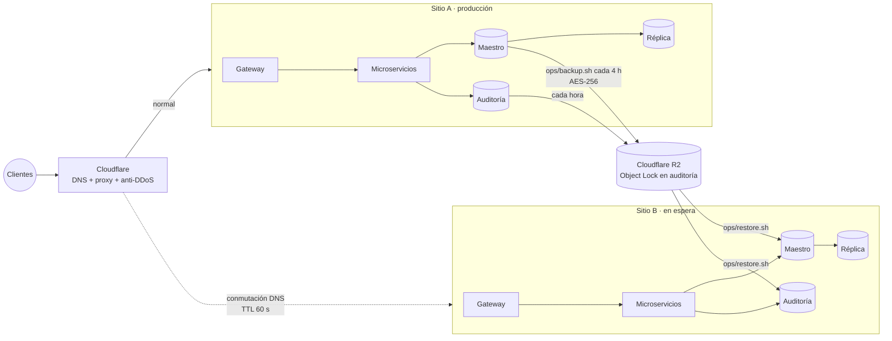

# Huellitas — Plan de continuidad (BCP) y recuperación ante desastres (DRP)

**Objetivo:** que la tienda vuelva a vender en **menos de 60 minutos** ante cualquiera de los escenarios de este plan, sin perder pagos ni la trazabilidad de la bitácora.

**Responsables:** Administrador del sistema (titular) · Desarrollador de guardia (suplente) · Dueño del negocio (comunicación con clientes y decisión de activar el sitio B).

---

## 1. Análisis de impacto (BIA)

| Servicio | Criticidad | RTO | RPO | Depende de | Por qué |
|---|---|---|---|---|---|
| pagos-service | CRÍTICA | 10 min | 0 | maestro, Redis, Stripe/PayPal | Sin él no hay ventas. Los pagos viven también en Stripe/PayPal, así que se reconcilian desde la pasarela (RPO 0) |
| auth-service | CRÍTICA | 10 min | 0 | maestro, Redis | Sin login no se puede comprar ni administrar |
| catalogo-service | CRÍTICA | 15 min | 5 min | réplica (o maestro), Redis | Es la vitrina. Mientras tanto la caché de Redis sigue sirviendo el catálogo |
| BD maestra | CRÍTICA | 10 min | 5 min | volumen `master_data` | Guarda usuarios, catálogo, pedidos y pagos |
| pedidos-service | ALTA | 20 min | 5 min | maestro, catálogo, pagos | Los pedidos se pueden rehacer con la información de Stripe y del correo |
| Redis | ALTA | 15 min | 0 (se recalcula) | volumen `redis_data` (AOF) | La lista negra de JWT persiste con AOF. La caché se reconstruye sola |
| security-audit-service | ALTA | 30 min | 15 min | BD de auditoría | Mientras no responde, los eventos quedan en el log del contenedor (`AUDITORIA_PENDIENTE`) y se reingresan |
| notificaciones-service | MEDIA | 60 min | 30 min | EmailJS | El correo se puede reenviar. El pedido no depende de él |
| Gateway | CRÍTICA | 10 min | — | certificados | Sin estado: se vuelve a levantar desde la imagen |

---

## 2. Escenarios de incidente y respuesta

### Escenario 1 — Ransomware en la BD maestra · Prob. **media** · Impacto **crítico**

| Fase | Acción |
|---|---|
| Detección | Healthcheck del maestro en rojo, 500 en `/api/pedidos/*`, archivos `.ibd` ilegibles |
| Contención | Aislar el host (sacarlo de la red), **no pagar**, preservar el volumen para el análisis forense (`docker volume` → snapshot) |
| Recuperación | Maestro nuevo con volumen limpio → `ops/restore.sh <último respaldo> negocio` → réplica nueva (se pone al día sola) → invalidar la caché del catálogo. Si el host entero está comprometido, todo se levanta en el **sitio B** |
| Verificación | Conteos iguales a los del último respaldo, cadena de hashes íntegra, prueba de compra |
| **Probado** | ✅ `ops/simulacro-drp.sh` · **RTO medido: 12,4 s** desde la detección ([informe](simulacros/)) |

### Escenario 2 — DDoS al API Gateway · Prob. **alta** · Impacto **alto**

- **Prevención:** Cloudflare (plan gratuito) delante del dominio, en modo proxy, con "Under Attack" disponible. En Nginx: rate limit por IP y por servicio, `limit_conn 50`, `client_body_timeout 10s` y `client_max_body_size 1m`. Además, el catálogo se sirve desde Redis y la réplica, y cada contenedor tiene `mem_limit`/`cpu_shares` para que uno saturado no tumbe a los demás.
- **Respuesta:** activar "Under Attack" o un challenge para `/api/*`, bajar los límites de `zone=catalogo` y `zone=login`, bloquear ASN o países en Cloudflare, y escalar horizontalmente las réplicas del catálogo (`docker compose up --scale`).
- **RTO objetivo:** 15 min.

### Escenario 3 — Fuga de datos de clientes · Prob. **baja** · Impacto **crítico**

- **Alcance limitado por diseño:** no hay tarjetas (PCI), las contraseñas son bcrypt de costo 12 y la exportación es de datos mínimos.
- **Respuesta:**
  1. Aislar el servicio comprometido (se le quita la red `interna`).
  2. Rotar `JWT_SECRET`. Eso invalida **todas** las sesiones.
  3. Rotar las contraseñas de BD y las claves de API.
  4. Revisar la bitácora: `EXPORTACION_CLIENTES`, `ACCESO_DENEGADO`, `ACCESO_ADMIN_PANEL` y `LOGIN_CLIENTE_FALLIDO` con resultado `FRAUDE`.
  5. Verificar `/api/auditoria/integridad`.
- **Notificación:** a los afectados y a la autoridad en **menos de 72 h** (buena práctica, alineada con el GDPR), con qué datos salieron y qué hacer (cambiar la contraseña).

### Escenario 4 — Caída del hosting principal · Prob. **baja** · Impacto **alto**

- **Sitio B:** un segundo proveedor (por ejemplo Railway o un VPS de otro proveedor) con el mismo `docker-compose.yml` + `docker-compose.prod.yml`, el `.env` guardado en el gestor de secretos y el último respaldo de R2/S3.
- **Conmutación:**
  1. `docker compose up -d` en el sitio B.
  2. `ops/restore.sh` con el último respaldo remoto.
  3. Cambiar el registro DNS en Cloudflare. Con TTL de 60 s y proxy activo, el cambio es inmediato.
- **RTO objetivo:** 45 min. **RPO:** el del último respaldo remoto (≤ 4 h; 5 min con binlogs remotos).

### Escenario 5 — Certificado TLS vencido · Prob. **alta** · Impacto **alto**

- **Prevención:** Let's Encrypt con renovación automática (certbot cada 12 h, renueva a los 60 días de los 90) y recarga de Nginx después de renovar. Alerta 14 días antes del vencimiento (correo de Let's Encrypt + monitor externo).
- **Respuesta:** `certbot renew --force-renewal` + `docker compose exec gateway nginx -s reload`. Si falla el desafío HTTP-01, usar DNS-01 con el token de Cloudflare.
- **RTO objetivo:** 15 min.

### Escenario 6 — Credenciales de administrador comprometidas · Prob. **media** · Impacto **crítico**

- **Detección:** `LOGIN_CLIENTE_FALLIDO` marcado `FRAUDE` (la misma cuenta desde 3 o más IPs), `ACCESO_ADMIN_PANEL` desde una IP o un navegador desconocido, `PRECIO_MODIFICADO` o `EXPORTACION_CLIENTES` fuera de horario.
- **Respuesta:**
  1. Revocar los JWT activos. El JWT de 1 h más la lista negra en Redis cortan el acceso; si hace falta cortarlo ya mismo, se rota `JWT_SECRET`.
  2. Desactivar la cuenta (`usuarios.activo = 0`) y forzar el cambio de contraseña.
  3. Revisar en la bitácora todo lo que hizo la cuenta desde el primer acceso sospechoso: precios con `dato_anterior`, estados de pedidos y exportaciones.
  4. Revertir los cambios.
- **RTO objetivo:** 30 min.

---

## 3. Estrategia de respaldo

| Componente | Tipo | Frecuencia | Retención | Dónde | Cómo |
|---|---|---|---|---|---|
| BD de negocio (maestro) | Completo `mariadb-dump --single-transaction` + binlogs | Diario 03:00 + cada 4 h | 30 días | Local cifrado + Cloudflare R2 | `ops/backup.sh` (cron), AES-256-CBC + PBKDF2, SHA-256 |
| Bitácora (`audit_db`) | Completo | Cada hora | 2 años | R2 con **Object Lock** (WORM) | `ops/backup.sh` · nadie puede borrar ni sobrescribir |
| Imágenes de productos | CDN redundante | Continuo | Indefinido | Cloudinary | Original en Cloudinary + URL en `catalogo_db` |
| Código fuente | Git | Cada push | Indefinido | GitHub | Incluye compose, Nginx y SQL de inicio |
| Imágenes Docker | Build de CI | Por versión | Últimas 5 | GHCR | Reconstruibles desde el código |
| Secretos (`.env`) | Manual | Cada cambio | Historial | Gestor de contraseñas (fuera del servidor) | Sin `BACKUP_PASSPHRASE` los respaldos no se pueden restaurar |

```cron
# /etc/cron.d/huellitas-respaldos
0 3 * * *      deploy cd /srv/huellitas && ops/backup.sh >> /var/log/huellitas-backup.log 2>&1
0 */4 * * *    deploy cd /srv/huellitas && ops/backup.sh >> /var/log/huellitas-backup.log 2>&1
0 4 1 * *      deploy cd /srv/huellitas && ops/simulacro-drp.sh --si >> /var/log/huellitas-drp.log 2>&1   # en el sitio B
```

**Prueba de restauración:** el simulacro mensual corre en el sitio B (nunca en producción) y deja su informe en `docs/simulacros/`.

---

## 4. Topología de recuperación



| Paso de la conmutación al sitio B | Tiempo estimado |
|---|---|
| Decidir activar el sitio B (dueño + administrador) | 10 min |
| `docker compose up -d` (imágenes ya descargadas) | 3 min |
| `ops/restore.sh` del último respaldo de R2 (descarga + restauración) | 5 min |
| Verificación (conteos, integridad de la bitácora, compra de prueba) | 10 min |
| Cambio de DNS en Cloudflare y propagación (proxy, TTL 60 s) | 2 min |
| **Total** | **≈ 30 min (< 60 min)** |

---

## 5. Comunicación durante un incidente

1. **0–15 min:** el administrador confirma el incidente y avisa al dueño.
2. **15–30 min:** aviso en redes sociales y en la portada ("estamos en mantenimiento, tus pagos están seguros").
3. **Al cerrar:** informe con línea de tiempo, causa raíz, datos afectados (de la bitácora) y acciones para que no se repita.
